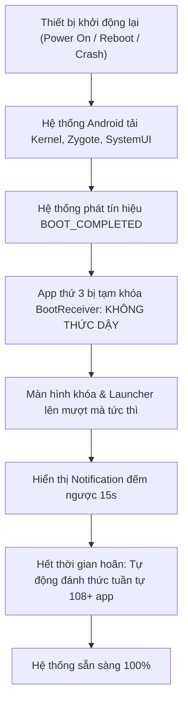

# ⚡ Boot Delay Manager (Android / Magisk / KernelSU / APatch)

> **Kiểm soát và hoãn khởi động các ứng dụng bên thứ 3 khi thiết bị Android khởi động lại, giúp tối ưu tốc độ boot, giảm giật lag và giải phóng CPU/RAM tức thì.**


---

## 📌 Vấn đề thực tế & Giải pháp

Khi thiết bị Android khởi động lại (đặc biệt là sau khi bị crash hoặc force reboot), hệ thống phát tín hiệu `BOOT_COMPLETED` và `LOCKED_BOOT_COMPLETED`. Hàng loạt ứng dụng bên thứ 3 (Facebook, Messenger, Zalo, YouTube, VPN, game...) đồng loạt thức dậy và chạy tiến trình nền cùng một lúc.

Hậu quả:
* **Boot lag / Giật đơ:** Màn hình khóa và Launcher bị khựng, phản hồi chậm trong 30 – 60 giây đầu.
* **Nghẽn tài nguyên:** CPU hoạt động 100%, RAM bị chiếm dụng dồn dập, máy nóng nhanh.

**Boot Delay Manager** giải quyết triệt để vấn đề này: Khi máy boot, hệ thống chỉ tập trung tải các dịch vụ hệ thống cốt lõi. Toàn bộ ứng dụng bên thứ 3 sẽ bị giữ lại và hoãn chạy (delay) theo số giây bạn tùy chỉnh (ví dụ `15s`), sau đó mới tuần tự được đánh thức.

---

## 🔥 Tính năng nổi bật

* 🎯 **Cơ chế khóa BootReceiver bền vững:** Vô hiệu hóa trực tiếp các broadcast receiver khởi động của app thông qua PackageManager. Tuyệt đối không bị *race condition* (chạy đua tiến trình) dù chip máy cực mạnh.
* ⏳ **Thông báo đếm ngược thời gian thực (Live Notification):** Ngay khi màn hình khóa xuất hiện, một thông báo đếm ngược từng giây (`15s... 14s...`) hiển thị trực quan trên thanh trạng thái.
* 🌐 **Tích hợp WebUI Dashboard:** Quản lý và cấu hình trực quan qua giao diện web Dark Mode tại `http://localhost:8888`.
* ⚡ **Nút Action 1-Click:** Hỗ trợ tính năng `action.sh` trong Magisk và KernelSU — chỉ cần bấm nút **[Action]** trên thẻ module để mở ngay WebUI mà không cần gõ URL.
* 📱 **Linh hoạt lựa chọn:** Hỗ trợ hoãn **toàn bộ ứng dụng người dùng** hoặc **tùy chọn riêng lẻ từng app**.
* 🛡️ **An toàn tuyệt đối:**
  * Các ứng dụng bị hoãn vẫn mở lên và sử dụng bình thường bất cứ lúc nào khi bạn bấm vào icon.
  * Khi gỡ module (`uninstall.sh`) hoặc tắt tính năng, toàn bộ ứng dụng sẽ tự động được khôi phục nguyên trạng.

---

## 🛠️ Cơ chế hoạt động (How It Works)



---

## 📥 Hướng dẫn cài đặt

### Cách 1: Flash qua Magisk / KernelSU / APatch
1. Tải bản zip phát hành mới nhất: [`BootDelayManager-v1.2.0.zip`](./BootDelayManager-v1.2.0.zip).
2. Mở app **Magisk** hoặc **KernelSU** / **APatch**.
3. Vào mục **Modules** -> Chọn **Install from storage** -> Chọn file zip.
4. Khởi động lại thiết bị (Reboot).

### Cách 2: Cài đặt qua ADB
```bash
# Đẩy file zip vào máy
adb push BootDelayManager-v1.2.0.zip /sdcard/

# Sau đó vào Magisk/KernelSU flash file zip từ /sdcard
```

---

## ⚙️ Cấu hình & Sử dụng

### 1. Mở giao diện cấu hình WebUI
* **Cách nhanh nhất:** Mở app Magisk / KernelSU -> Tại module **Boot Delay Manager**, bấm nút **[Action]** ⚡ -> Trình duyệt sẽ tự động mở trang cấu hình.
* **Hoặc mở trực tiếp trên điện thoại:** Truy cập `http://localhost:8888`.
* **Cấu hình từ PC qua ADB:**
  ```bash
  adb forward tcp:8888 tcp:8888
  ```
  Sau đó mở trình duyệt máy tính vào: `http://localhost:8888`.

### 2. Tùy chỉnh cài đặt
1. **Bật cơ chế hoãn Boot:** Bật/Tắt module.
2. **Thời gian Delay:** Nhập số giây mong muốn (mặc định: `15` giây).
3. **Phạm vi hoãn:**
   * Bật *Hoãn TOÀN BỘ app bên thứ 3*: Áp dụng cho mọi app cài thêm (`-3`).
   * Hoặc tìm kiếm và tích chọn riêng từng app nặng (Zalo, Messenger, Facebook, TikTok...).
4. Bấm **LƯU CẤU HÌNH** 💾.

---

## 📂 Cấu trúc dự án

```text
bootmanager/
├── module.prop                 # Thông tin module Magisk/KernelSU
├── service.sh                  # Core Daemon: HTTP server, notification & countdown
├── action.sh                   # Nút Action 1-click mở WebUI từ Magisk/KernelSU
├── customize.sh                # Script thiết lập quyền khi flash zip
├── uninstall.sh                # Dọn dẹp & khôi phục trạng thái app khi gỡ module
├── config.json                 # Cấu hình lưu trữ (delay, danh sách app)
├── webroot/                    # Giao diện WebUI & REST API
│   ├── index.html              # Frontend Dark Mode Dashboard
│   └── cgi-bin/
│       ├── get_apps.sh         # API lấy danh sách app & config
│       ├── save_config.sh      # API quét & disable BootReceivers
│       └── status.sh           # API kiểm tra nhật ký & trạng thái
└── BootDelayManager-v1.2.0.zip  # Gói cài đặt flashable sẵn sàng
```

---

## 📄 License

Dự án phát hành theo mã nguồn mở [MIT License](LICENSE). Tự do sử dụng, chỉnh sửa và đóng góp!

